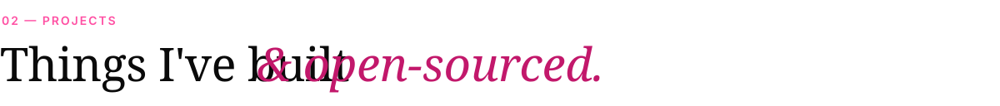

 

<picture><source media="(prefers-color-scheme: dark)" srcset="assets/sec-research-dark.svg"></picture>

<picture><source media="(prefers-color-scheme: dark)" srcset="assets/sec-projects-dark.svg"></picture>

<picture><source media="(prefers-color-scheme: dark)" srcset="assets/sec-toolkit-dark.svg"></picture>

  

<picture><source media="(prefers-color-scheme: dark)" srcset="assets/sec-contact-dark.svg"></picture>

&nbsp;
&nbsp;
&nbsp;

