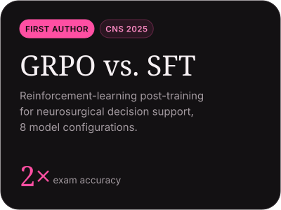

<a href="mailto:ss17775@nyu.edu">Email</a> &nbsp;·&nbsp;
<a href="https://www.linkedin.com/in/shrutika-singh-091297280/">LinkedIn</a> &nbsp;·&nbsp;
<a href="https://scholar.google.com/citations?hl=en&user=3Ewre4YAAAAJ">Google Scholar</a> &nbsp;·&nbsp;
<a href="https://shrusingh8.github.io/shrusingh.github.io/">Website</a>

### Research

### Projects

### Technical Skills

**Languages** Python, Java, R, SQL &nbsp;·&nbsp; **ML** PyTorch, pandas, scikit-learn, LLM APIs, fine-tuning (SFT, GRPO), RAG, LLM-as-judge evaluation &nbsp;·&nbsp; **Infrastructure** FastAPI, Docker, Git, GitHub Actions, Linux
